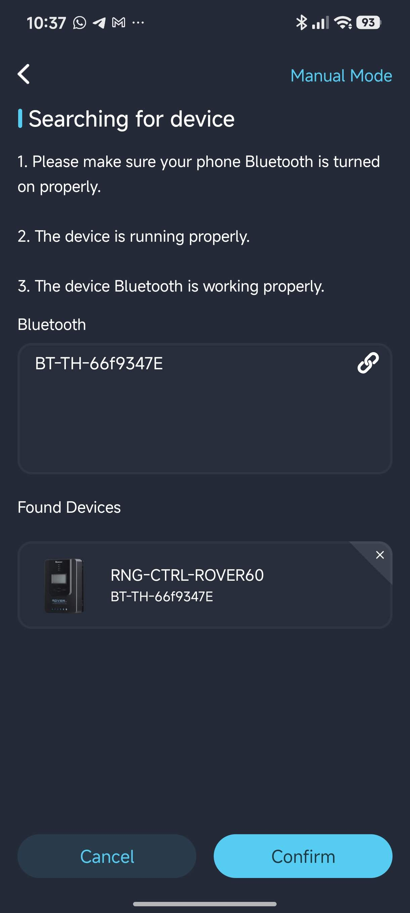
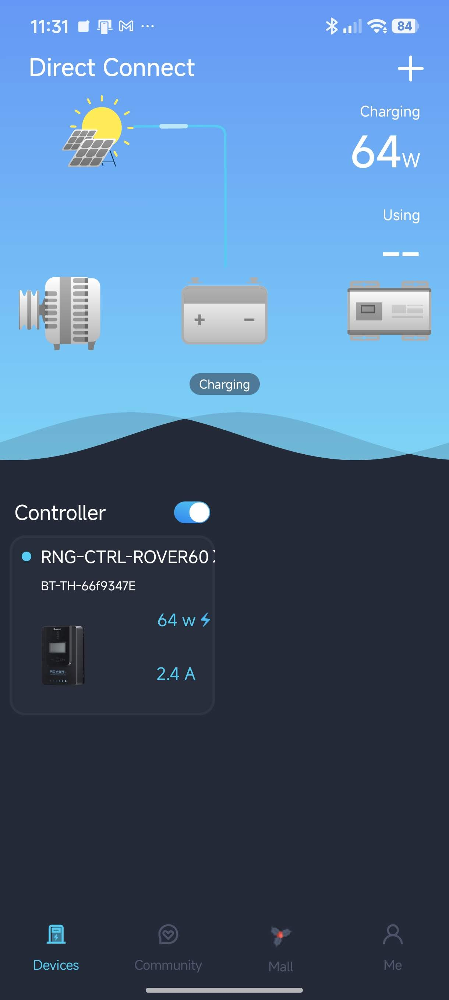
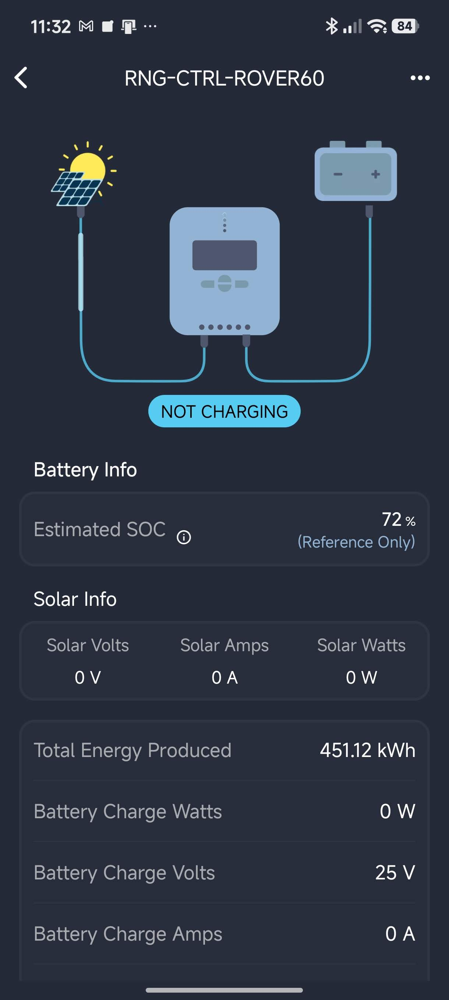
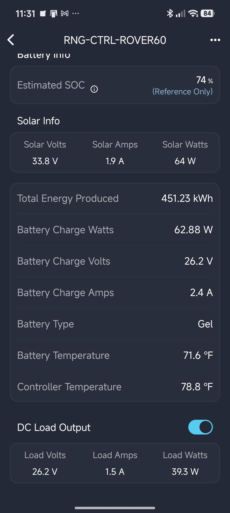

# librenogybt-emulator (`renogybt-emulator`)

`librenogybt-emulator` is a standalone Python library and CLI tool (`renogybt-emulator`) that emulates the hardware (BLE Peripheral + Modbus RTU slave) side of Renogy **BT-1** (RS232) and **BT-2** (RS485) Bluetooth Low Energy modules.

Inspired by Cyril Sebastian's [`renogy-bt`](https://github.com/cyrils/renogy-bt), this emulator works seamlessly with `renogy-bt` and other compatible Renogy BLE clients for hardware-free development, testing, and system integration.

It registers the exact BLE GATT Services (`0000ffd0-...`, `0000fff0-...`), GATT Characteristics (`0000ffd1-...` write, `0000fff1-...` notify), and Modbus RTU holding register banks (`0x000A–0x0027`, `0x0100–0x012B`, `0xE000–0xE040`, `0xF000–0xF01E`) used by Renogy Solar Charge Controllers (such as `RNG-CTRL-ROVER60`), Smart Lithium Batteries, Inverters, DC-DC Chargers, and Smart Shunts.

---

## Notice
This is not an official Renogy product nor endorsed by Renogy.


## Objectives & Verification Status

### Objectives
1. **Hardware-Free Development & Deployment Testing**: Enable developers and system integrators to test `renogy-bt` clients, MQTT / Home Assistant telemetry pipelines, PVOutput loggers, and mobile/desktop apps without physical solar panels, controllers, or batteries.
2. **Realistic Solar MPPT State Simulation**: Provide both fixed telemetry snapshots (`static` mode with live file hot-reloading) and automated time-based solar charging transitions (`cycle` mode rotating through `nighttime`, `early_morning`, `noon`, and `late_afternoon`).
3. **Turnkey Packaging**: Provide an installable Python wheel / sdist (`dist/librenogybt_emulator-0.1.0-py3-none-any.whl`) and CLI entrypoint (`renogybt-emulator`) ready to deploy on any fresh Linux machine with a Bluetooth adapter.

### Verified Compatibility
> **Verified with Official Renogy Mobile App & `renogy-bt`:**
> This emulator is verified to work over the air with both the **official Renogy mobile application** and `renogy-bt` (`example.py`), accurately emulating a **Renogy Rover MPPT (`RNG-CTRL-ROVER60`)** charge controller across live register slices, parameter reads, historical daily summaries, and dynamic state transitions.

#### Official Renogy Mobile App Screenshots

| BLE Device Discovery | Direct Connect Overview |
| :---: | :---: |
|  |  |
| **1. Searching for Device:** Official Renogy app discovering the emulated `BT-TH-66f9347E` (`RNG-CTRL-ROVER60`) over Bluetooth LE. | **2. Direct Connect Dashboard:** Live connection showing `RNG-CTRL-ROVER60` charging at `64W` (`2.4A`). |

---

## Fresh Machine Installation & Setup Guide

### 1. System Prerequisites (Fresh Linux Machine)
On a fresh Debian/Ubuntu/Raspberry Pi OS or Fedora/Arch Linux machine, ensure you have:
- **Bluetooth Hardware**: A built-in or USB Bluetooth 4.0+ (BLE) adapter (e.g., `hci0`).
- **System Packages**: Python 3.8+ (`python3`, `python3-venv`, `python3-pip`) and BlueZ utilities (`bluez`, `bluetooth`):
  ```bash
  # Debian / Ubuntu / Raspberry Pi OS
  sudo apt update
  sudo apt install -y python3 python3-venv python3-pip bluez
  ```

### 2. Install `librenogybt-emulator` & `renogybt-emulator`
Copy or clone this directory (`renogybt-emulator`) onto the target machine, create a virtual environment, and install the package (either from source or from the pre-built wheel in `dist/`):

```bash
cd /path/to/renogybt-emulator

# 1. Create and activate a Python virtual environment
python3 -m venv .venv
source .venv/bin/activate

# 2. Install dependencies from requirements.txt
pip install -r requirements.txt

# 3. Install librenogybt-emulator and the renogybt-emulator CLI
pip install .
# (Or install directly from the built wheel: pip install dist/librenogybt_emulator-0.1.0-py3-none-any.whl)
```

Verify the CLI is installed:
```bash
.venv/bin/renogybt-emulator --help
```

### 3. Prepare the Bluetooth Adapter (`hci0`)
Check your Bluetooth adapter's MAC address and ensure LE advertising, connectable, and discoverable modes are enabled:

```bash
# View your adapter name and MAC address (BD Address)
hciconfig -a hci0

# Power on and enable BLE peripheral advertising flags
sudo hciconfig hci0 up
sudo btmgmt --index 0 le on
sudo btmgmt --index 0 connectable on
sudo btmgmt --index 0 discov on
```

---

## Operating Modes: `static` and `cycle`

### Mode 1: `static` Mode (Single State + Hot-Reload)
Serves a fixed set of solar controller parameters from your `.json` or `.ini` config file. Any edits saved to the config file while the emulator is running are **hot-reloaded automatically** on the next Modbus poll.

```bash
# Start with the 24V Gel Noon static JSON config
sudo .venv/bin/renogybt-emulator -c configs/rover_24v_gel_noon.json -v

# Start with the default INI config
sudo .venv/bin/renogybt-emulator -c configs/emulator_config.ini -v
```

### Mode 2: `cycle` Mode (4 Solar MPPT States)
Automatically cycles through four solar MPPT operating states at a configurable interval (`--state-interval`, supporting seconds like `15s`, `30s` or minutes like `2m`, `5min`):

| State | Description | `charging_status` | PV Array | Battery (24V Gel) | DC Load |
| :--- | :--- | :--- | :--- | :--- | :--- |
| **`nighttime`** | Battery discharging only | `deactivated` | `0.0V` / `0.0A` / `0W` | `25.0V` / `0.0A` / `72%` | `on` (`3.6A` / `90W`) |
| **`early_morning`** | Minimal solar radiation | `mppt` | `33.8V` / `1.9A` / `64W` | `26.2V` / `2.4A` / `74%` | `on` (`1.5A` / `39W`) |
| **`noon`** | Peak solar charging | `mppt` | `42.6V` / `12.8A` / `545W` | `28.4V` / `18.5A` / `88%` | `on` (`2.5A` / `71W`) |
| **`late_afternoon`** | Slow / float charging | `floating` | `36.4V` / `2.5A` / `91W` | `27.6V` / `3.2A` / `98%` | `on` (`2.0A` / `55W`) |

```bash
# Switch states every 30 seconds
sudo .venv/bin/renogybt-emulator -c configs/rover_24v_gel_states.json --mode cycle --state-interval 30s -v

# Switch states every 2 minutes, starting at 'noon'
sudo .venv/bin/renogybt-emulator -c configs/rover_24v_gel_states.ini --mode cycle --state-interval 2m --initial-state noon -v
```

#### Solar MPPT State Transitions in Official Renogy App (`cycle` Mode)

| `nighttime` State (`NOT CHARGING`) | `early_morning` State (`MPPT Charging`) |
| :---: | :---: |
|  |  |
| **`nighttime`:** `deactivated` (`NOT CHARGING`), `72%` SOC, `0V` / `0A` / `0W` PV, `25V` battery (`451.12 kWh` total). | **`early_morning`:** `mppt` charging, `74%` SOC, `33.8V` / `1.9A` / `64W` PV, `26.2V` / `2.4A` Gel battery, and DC Load `ON` (`26.2V` / `1.5A` / `39.3W`). |

---

## Configuration Guide (Fresh Machine)

Configuration files are located in `configs/` (and root convenience copies):
- `configs/emulator_config.ini` — Default preset config (`RNG-CTRL-ROVER60`)
- `configs/rover_24v_gel_noon.json` & `.ini` — Static 24V Gel battery charging at noon
- `configs/rover_24v_gel_states.json` & `.ini` — 4-state solar MPPT cycling config

### Configuring Adapter MAC & `BT-TH-xxxxxxxx` Alias on a New Machine
When deploying on a new machine, check your Bluetooth adapter's MAC address via `hciconfig hci0` (for example, `AA:BB:CC:11:22:33`):
1. **Automatic Alias (`alias = auto`)**: Setting `"alias": "auto"` in JSON or `alias = auto` in INI automatically names the BLE device `BT-TH-112233` using the last 6 hex characters of your `hci0` MAC address (or use `auto8` for the last 8 hex characters).
2. **Custom Alias**: You can also set any explicit `BT-TH-` string (e.g., `BT-TH-66f9347E`) in the config file or via `--alias BT-TH-112233`.

### Example Static Config (`configs/rover_24v_gel_noon.json`)
```json
{
  "battery_percentage": 88,
  "battery_voltage": 28.4,
  "battery_current": 18.5,
  "battery_temperature": 28,
  "controller_temperature": 41,
  "load_status": "on",
  "load_voltage": 28.4,
  "load_current": 2.5,
  "load_power": 71,
  "pv_voltage": 42.6,
  "pv_current": 12.8,
  "pv_power": 545,
  "max_charging_power_today": 580,
  "max_discharging_power_today": 95,
  "charging_amp_hours_today": 64,
  "discharging_amp_hours_today": 12,
  "power_generation_today": 1680,
  "power_consumption_today": 310,
  "power_generation_total": 452800,
  "charging_status": "mppt",
  "battery_type": "gel"
}
```

---

## Troubleshooting

1. **Emulator Not Showing Up in BLE Scans**:
   - **Existing Connection**: A BLE peripheral stops advertising while a central device (phone or client PC) is actively connected. Disconnect the previous client (`bluetoothctl devices Connected` -> `bluetoothctl disconnect <MAC>`).
   - **Adapter Flags Reset**: Run `sudo hciconfig hci0 down && sudo hciconfig hci0 up`, then re-apply `sudo btmgmt --index 0 le on`, `connectable on`, and `discov on`.
   - **`BT-TH-` Suffix Mismatch**: Some apps/clients expect the characters after `BT-TH-` to match the last 6 hex digits of the Bluetooth adapter's MAC address. Run with `--alias auto` or set `alias = auto` in your config.
2. **`Bluetooth: hci0: Opcode 0x2039 failed: -12` in `dmesg`**:
   - Indicates the Bluetooth controller rejected an overlapping extended advertising request (`-ENOMEM` / Command Disallowed). Ensure only **one** instance of `renogybt-emulator` is running (`pkill -f renogybt-emulator`) and reset `hci0` (`sudo hciconfig hci0 down && sudo hciconfig hci0 up`).
3. **D-Bus Permission Denied (`org.freedesktop.DBus.Error.AccessDenied`)**:
   - BlueZ requires `root` (or `bluetooth` group membership) to register GATT services and LE advertisements on the system D-Bus. Run `sudo .venv/bin/renogybt-emulator ...`.

---

## Submitting Bugs

When reporting issues or bugs, please attach:
1. The exact command and configuration file (`.json` / `.ini`) used.
2. Full debug logs from running `renogybt-emulator -v`.
3. Output of `hciconfig -a hci0`, `btmgmt --index 0 info`, and `bluetoothd -v` on the host machine.
4. Client details (`renogy-bt` version/config or official Renogy app version and mobile OS).

---

## Credits & Acknowledgements

Inspired by Cyril Sebastian's [`renogy-bt`](https://github.com/cyrils/renogy-bt), this library is designed to work seamlessly with `renogy-bt` and any compatible Renogy BLE client.

## Copyright & License

Copyright (c) 2026 Mohammad Hafiz bin Ismail (mypapit@gmail.com) - <http://mypapit.net>

This project is licensed under the **GNU General Public License version 3 (GNU/GPL v3)**. See the [LICENSE](LICENSE) file for details.
